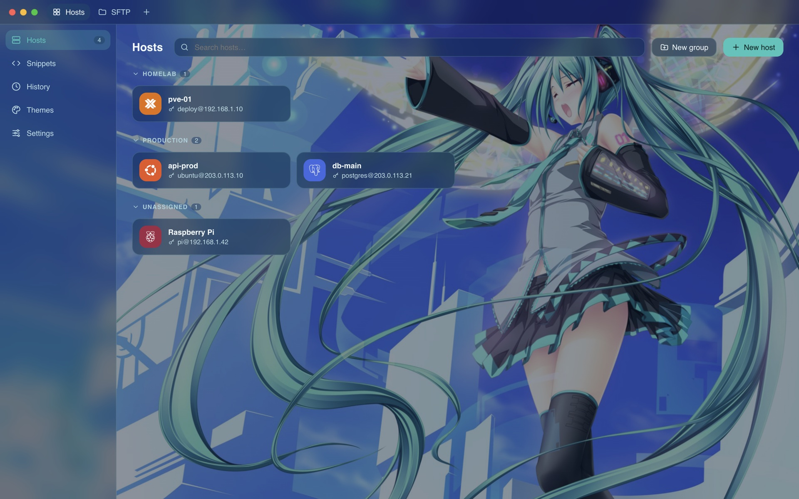

# harussh

Modern personal SSH client.



## Installation

Requires [Node.js](https://nodejs.org/) 22 or newer.

Build the installer for your system:

```bash
npm run dist:mac    # macOS   → release/harussh-*.dmg
npm run dist:win    # Windows → release/harussh Setup *.exe
npm run dist:linux  # Linux   → release/harussh-*.AppImage, .deb
```

Open the file from `release/` and install it like any other app.

To run it without installing:

```bash
npm run dev
```
